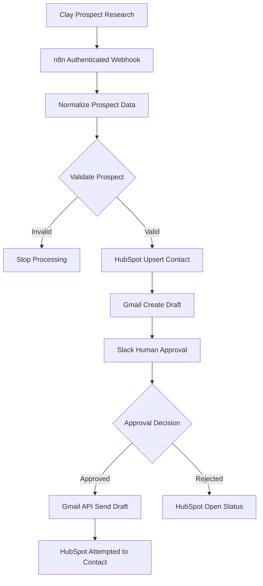

# Technical Architecture

## 1. System Overview

The AI Marketing & Sales Engine is a modular lead generation and outreach automation system designed to connect prospect intelligence, CRM management, personalized communication, and human decision-making.

The architecture separates prospect research from outreach execution, ensuring that emails require explicit human approval before being sent.

**Version:** 0.1 — Working Prototype

## 2. Technology Stack

| Technology | Responsibility |
|---|---|
| Clay | Prospect discovery, enrichment and AI-assisted personalization |
| n8n | Workflow orchestration and business logic |
| JavaScript | Data transformations, expressions and validation |
| HubSpot | Contact management and lead status tracking |
| Gmail | Email draft creation and approved email delivery |
| Slack | Human-in-the-loop approval interface |
| Calendly | Meeting scheduling — planned integration |

## 3. System Architecture

## 4. Input Data Schema

The workflow receives a structured JSON payload from Clay.

| Field | Type | Required by validation |
|---|---|---|
| first_name | String | Yes |
| last_name | String | No |
| email | String | Yes |
| company_name | String | Yes |
| job_title | String | No |
| linkedin_url | String | No |
| email_subject | String | Yes |
| email_body | String | Yes |
| outreach_status | String | Yes |

The outreach_status must equal Draft.

## 5. Workflow Implementation

### 5.1 Prospect Intake

An authenticated HTTP POST webhook receives prospect information from Clay.

Header authentication protects the webhook from unauthorized requests.

### 5.2 Data Normalization

The incoming payload is transformed into a consistent internal data structure using n8n expressions.

This separates external data formatting from downstream workflow logic.

### 5.3 Prospect Validation

The validation layer checks:

- Required prospect information
- Basic email address format
- Email subject and body availability
- Company name availability
- Draft outreach status

Invalid records do not proceed to CRM processing or outreach.

Email format validation does not guarantee mailbox existence or deliverability.

### 5.4 CRM Management

HubSpot creates or updates contacts using their email address.

Contact properties include:

- First name
- Last name
- Email address
- Company name
- Job title
- LinkedIn profile URL

Contact upserting reduces duplicate CRM records. Duplicate outreach prevention requires additional logic.

### 5.5 Email Draft Generation

Personalized email content generated upstream is passed to Gmail.

The workflow creates a draft rather than immediately sending the email.

### 5.6 Human-in-the-Loop Approval

Slack receives an approval request containing:

- Prospect information
- Company and job title
- Recipient email address
- Personalized email subject
- Complete email body

The authorized reviewer can select:

- Approve & Send
- Reject

The workflow waits for the approval decision before continuing.

Responder identification and restricted approver access are configured in the original implementation.

### 5.7 Approved Outreach

When approval is granted:

1. The Gmail API sends the existing draft.
2. HubSpot updates the contact's lead status to ATTEMPTED_TO_CONTACT.

The CRM update occurs after the Gmail API request succeeds.

### 5.8 Rejected Outreach

When approval is declined:

1. The email is not sent by the workflow.
2. HubSpot updates the lead status to OPEN.

Rejected drafts remain in Gmail. Automated draft cleanup is a future improvement.

## 6. Security and Responsible Automation

Implemented controls:

- Authenticated webhook intake
- OAuth-based Gmail and HubSpot integrations
- Credential management through n8n
- Required-field validation
- Restricted human approval
- Explicit approval before automated email delivery
- Separate approval and rejection branches

The repository contains a sanitized workflow export without original account-specific credential references.

Users must configure their own credentials, Slack channel and authorized approver before execution.

Additional production requirements include:

- Data retention and privacy controls
- Outreach eligibility and consent checks
- Suppression and opt-out management
- Duplicate outreach prevention
- Rate limiting and monitoring

Human approval alone does not establish legal compliance.

## 7. Testing and Validation

| Test | Result |
|---|---|
| Authenticated webhook intake | Passed in controlled testing |
| Prospect data normalization | Passed in controlled testing |
| HubSpot contact creation | Passed |
| HubSpot contact upsert | Passed |
| Gmail draft creation | Passed |
| Slack approval request | Passed |
| Approved email delivery | Passed — received in spam |
| Rejection branch | Passed — email not sent |
| CRM status after approval | Passed |
| CRM status after rejection | Passed |
| Dynamic Clay production payload | Pending |
| Sanitized workflow reimport | Pending |
| Duplicate outreach prevention | Pending |
| Production deployment | Pending |

Testing was conducted using controlled test data.

No production-scale performance or conversion metrics have been established.

## 8. Engineering Design Decisions

### Modular Architecture

Each platform has a defined responsibility, allowing individual components to be improved without redesigning the entire system.

### Human-Controlled Execution

AI-assisted personalization is separated from email delivery to reduce the risk of inappropriate or inaccurate automated communication.

### CRM as the Contact Management Layer

HubSpot maintains contact records and outreach status independently of the workflow execution interface.

### Draft-First Approach

Creating an email draft before requesting approval allows the system to send the existing prepared message after authorization.

### API-Based Integration

The Gmail drafts.send API is used to deliver the approved draft, rather than creating a separate email during the sending stage.

## 9. Current Limitations

- Production deployment is not yet complete.
- Email deliverability requires improvement.
- Duplicate drafts and repeated outreach require additional safeguards.
- Rejected drafts require manual cleanup.
- Automated error recovery and retry policies are not yet implemented.
- Outreach compliance checks require further development.
- Calendly integration is not yet implemented.
- The sanitized repository export requires reconfiguration and testing before use.

## 10. Development Roadmap

### Phase 1 — Core Outreach Engine

- Complete dynamic Clay integration testing
- Implement duplicate outreach prevention
- Improve email deliverability
- Add production safeguards

### Phase 2 — Sales Automation

- Integrate Calendly
- Automate meeting notifications
- Update CRM records following bookings
- Implement compliant follow-up workflows

### Phase 3 — Analytics and Optimization

- Outreach performance reporting
- Conversion funnel analysis
- Workflow execution monitoring
- Cost and operational efficiency analysis

## 11. Workflow Source

The sanitized n8n workflow is available here:

[Prospect Intake Workflow](../workflows/prospect-intake.json)

---

Designed and developed by Uliana.

Fractional CMO & Marketing Engineer
